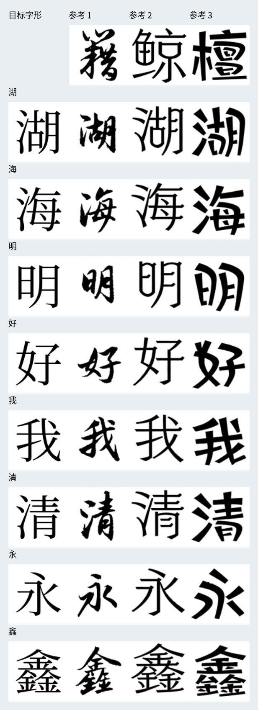
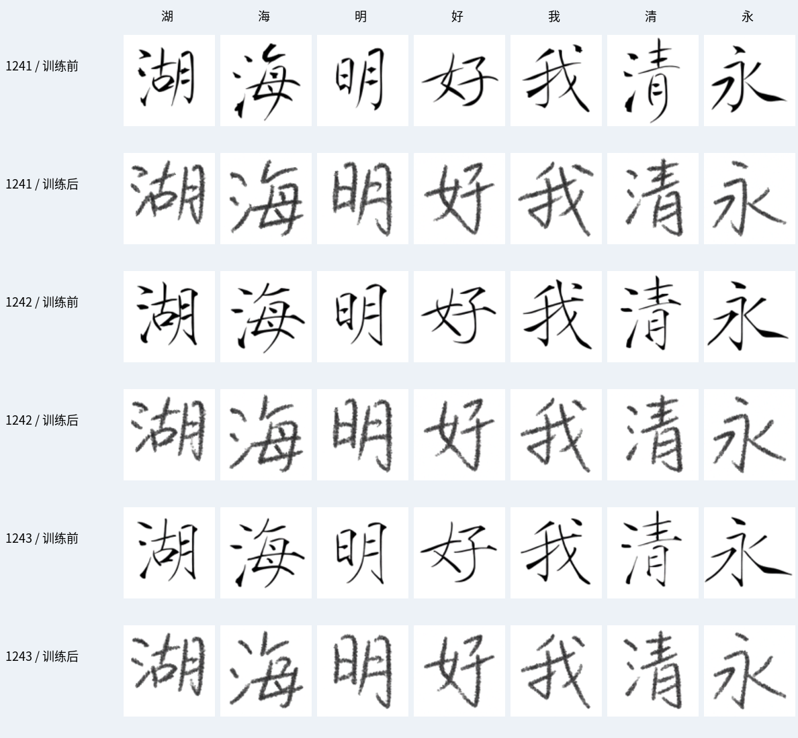

# giaok_write：少样本中文手写生成

最终目标：输入中文文本和少量参考手写，生成内容正确、风格接近参考者的图像。
当前阶段：建立中文单字生成基线与公共多书写者底座。个人微调、整行布局暂不开展。

## 项目导航

- [第一阶段流程](docs/PHASE1_GUIDE.md)：任务、数据、模型、训练与验收。
- [基线目标](docs/BASELINE_GOAL.md)：这轮实验的范围与完成条件。
- [论文索引](papers/README.md)：前面讨论的论文及下载状态。
- [预训练推理记录](experiments/baseline_001/REPORT.md)：实际环境、命令、结果和限制。
- [短训练记录](experiments/training_demo_001/REPORT.md)：从随机初始化的官方示例训练及采样。
- [CASIA 首轮训练报告](experiments/casia_001/REPORT.md)：完整 HWDB1.1 下载、5,000 步共享训练、117 个固定案例前后对照。
- [CASIA 运行流程](docs/casia/RUN_PLAN.md)：下载、解包、转换、训练和检查命令。
- [环境说明](docs/ENVIRONMENT.md)：依赖兼容与复现。
- `vendor/FontDiffuser/`：按固定提交下载的官方代码。
- `scripts/`：资源下载和可重复运行的实验入口。
- `checkpoints/`：模型权重，不纳入 Git。

## 快速运行

```bash
.venv/bin/python scripts/run_baseline.py --config configs/baseline_001.json
```

先阅读实验报告中的资源与环境要求。`baseline_001` 是官方预训练模型的本地推理复现；最新的 `casia_001` 已完成真实 CASIA 数据上的首轮共享训练。两者都不能证明新用户个人风格迁移质量已经达标。

原有 `main.py` 保留，新的实验入口位于 `scripts/`。

## 初步生成结果

8 个中文目标字 × 3 种官方风格参考，96×96，20 步，RTX 5070 实测平均约 0.657 秒/字。



第一列为目标模板，顶部为参考图片，右侧为模型生成结果。

## 短训练验证

额外从随机初始化，用官方 12 张示例训练了 1000 步，完成保存和重新加载。损失下降，但采样没有形成稳定字形；详情及失败样例见 [短训练报告](experiments/training_demo_001/REPORT.md)。随后已开展 CASIA 首轮训练，见下方结果；完整底座收敛仍需更长训练和扩大评估。

```bash
bash scripts/run_training_demo.sh
```

## CASIA 初步结果

HWDB1.1 已完整下载并转换：300 位书写者、3,755 类汉字、1,121,749 张汉字图像；按 216/24/60 位划分训练/验证/测试。官方下载连接超时，实际使用公开镜像，来源和 SHA-256 均有记录。

从官方 FontDiffuser 权重继续训练三模块，共 5,000 步、batch=2，约 13.9 分钟。最佳验证检查点为第 4,500 步，固定验证损失 0.102731 → 0.057844，下降约 43.7%。本轮只有 10,000 次样本暴露，未完成一个 epoch。



64 个随机官方测试字的生成 OCR 相符率 **95.31% → 90.62%**，21 个常用字保持 100%。手写笔迹外观更明显，但固定噪声换参考诊断中，三个目标的参考响应均减弱，个人结构差异仍不足；这轮完成了真实数据训练链路和初步结果，质量目标尚未通过。OCR 对真实随机目标仅为 56.25%，所以这些比例仅为辅助识别指标。

[完整报告](experiments/casia_001/REPORT.md)记录同条件生成结果、OCR 在真实手写上的校准、逐例 CSV 和局限。GitHub 发布代码、配置、日志和生成图；原始 CASIA、真实图像及权重保留本地，最佳权重路径为 `experiments/casia_001/checkpoints/best/`。

```bash
# 汇总、核验本轮已有结果
.venv/bin/python scripts/summarize_casia.py
.venv/bin/python scripts/verify_casia_results.py
```

从新目录完整复现请按 [CASIA 流程](docs/casia/RUN_PLAN.md) 下载并处理数据；同名训练和评估日志会拒绝覆盖。
