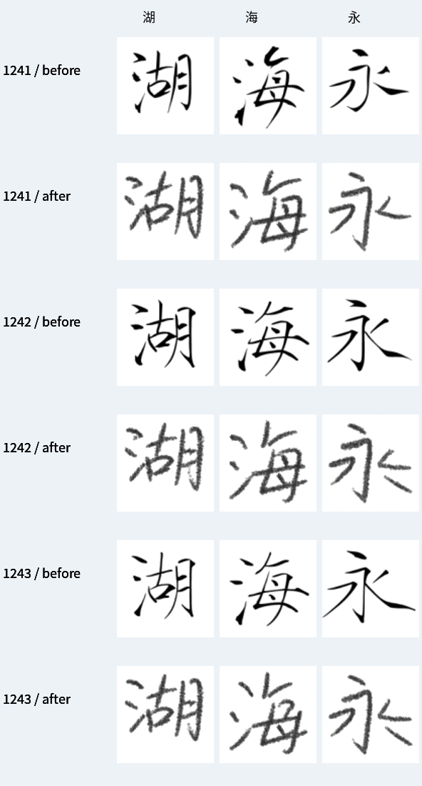
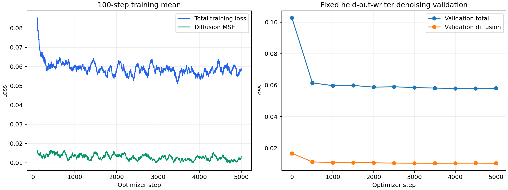

# CASIA-HWDB1.1 首轮共享手写底座训练

执行日期：2026-10-09。实验：`casia_001`。结果以本目录 JSON/JSONL 为准。

## 任务与结论

本轮已下载和转换 CASIA-HWDB1.1，使用全部公共训练书写者构造样本，从官方 FontDiffuser 预训练字体权重继续训练内容编码器、风格编码器及扩散 U-Net。模型仍是一个共享底座，没有做个人用户微调。

训练已完成，训练循环耗时 **13.88 分钟**。固定验证去噪总损失从 **0.102731** 降至最佳 **0.057844**（下降 **43.7%**），最佳检查点为第 **4500** 步。最后第 5,000 步损失为 0.057999。峰值已分配显存为 3.09 GiB，峰值 reserved 为 3.51 GiB。

生成图已从明显字体/毛笔式效果变为带灰度与粗糙笔迹的手写效果。但独立随机测试 OCR 相符率从 **61/64（95.31%）降至 58/64（90.62%）**；常用字 21/21 仍全部相符。三位书写者的生成结构仍高度相近，本轮没有达到“内容可靠且忠实保留个人风格”的验收目标。

这是 5,000 步的初步实验：batch=2，共 10,000 次训练样本暴露，只相当于训练集大小的约 1.24%，没有完成一轮遍历。不能据此宣称底座收敛、达到论文 SOTA 或能可靠复制新用户的书写风格。

## 数据下载和验证

CASIA 官方页面直连多次超时，实际通过 [AND-Q/HWDB1.1- 的公开 Release 镜像](https://github.com/AND-Q/HWDB1.1-/releases/tag/datasets) 下载完整训练/测试包。该镜像不是官方传输来源；SHA-256 与镜像 Release 的记录相符，没有可用的官方源端校验值供比对。另独立检查 GNT 结构、字符类别、样本数和书写者隔离。

| 压缩包 | 字节数 | SHA-256 |
|---|---:|---|
| HWDB1.1trn_gnt.zip | 1,919,025,714 | `1e00a630613cd796423710fc8b438e7176a4a8fef8dd25966f20940076dce817` |
| HWDB1.1tst_gnt.zip | 482,768,010 | `1d5060803574ac10c743b12e621de3cbbfd1e95fe69426da570f492e5cd5ee08` |

训练 ZIP 内嵌 ALZ，使用固定提交 `457884d21962caa12085bfb6ec5bd12f3eb93c00` 的 `kippler/unalz` 解出 240 个 GNT。测试包含 60 个 GNT。完整来源和校验见 [download_manifest.json](download_manifest.json)。

| 划分 | 书写者 | 汉字样本数 |
|---|---:|---:|
| train | 216 | 807,972 |
| validation | 24 | 89,786 |
| 官方 test | 60 | 223,991 |
| 总计 | 300 | 1,121,749 |

类别为 3,755 个汉字。官方训练中的 24 位按 seed=123 留作验证，三个集合的书写者无交集。发现 25 位书写者有重复标签，共 308 条额外记录；保留记录，参考采样按字符排除目标，避免同字泄漏。[data_summary.json](data_summary.json) 和 [dataset_manifest.json](dataset_manifest.json) 可复查。

处理保留灰度、宽高比、倾斜和笔画形态，最长边缩放至 80 后居中补白至 96×96。按书写者保存 uint8 NumPy 数组，通过 memmap 读取。内容模板使用 Noto Serif CJK 的简体中文 TTC index=2。`鑫` 不在本数据类别内，未混入词表内测试。

## 模型、监督与训练预算

每个训练样本：目标字符的标准字形模板 + 同书写者另一个字的真实参考 → 该书写者真实目标字。单参考条件与原模型接口一致。随机噪声和时间步用于扩散训练；书写者 ID 只用于配对，不是推理时的固定 ID 条件。

| 参数 | 实际设置 |
|---|---|
| 官方代码提交 | `7b28ce9c3b357f4fb23296622f458cf169803539` |
| 初始化 | 官方 FontDiffuser 三模块权重 |
| 可训练参数 | 100,486,831，三模块全部更新 |
| GPU / 精度 / 图像大小 | RTX 5070 12GB / FP32 / 96×96 RGB |
| 优化 | AdamW，lr=1e-5，weight_decay=0.01 |
| 学习率 / 梯度 | warmup=100，余弦至 1e-6，裁剪范数 1.0 |
| batch / 步数 | 2 / 5,000 |
| 条件丢弃 | 0.1 |
| 损失 | diffusion MSE + 0.01×VGG16 感知 + 0.5×offset |
| 验证 / 检查点 | 每 500 步固定验证；每 2,500 步保存与恢复状态 |

复用官方基础生成阶段，未加入 SCR 风格对比阶段、OCR 训练损失或个人 LoRA。x0 从预测噪声恢复的向量化公式已与 DDPM scheduler 的 `pred_original_sample` 比对，误差在 1e-6 内。完整配置见 [train_config.json](train_config.json)，运行环境和初始权重校验见 [train_environment.json](train_environment.json)。

## 固定对照协议

训练前已冻结 [evaluation_cases.json](evaluation_cases.json)：

- 32 个验证随机字，涉及 20 位验证书写者。
- 64 个官方测试随机字，涉及 40 位测试书写者。
- 21 个常用字展示：3 位官方测试书写者 × 湖、海、明、好、我、清、永。每位书写者统一以“人”为参考。

每个案例训练前后保持目标、参考和 seed 相同。推理用 DPM-Solver++，20 步，CFG=7.5。模型检查点只由固定验证去噪损失选择，没有在测试集上选择检查点或调参。

测试属于**未见书写者、参考里没有目标字**的设置；目标类别都在训练数据词表中，不是未见汉字类别测试。不同书写者的图库 seed 不同，不能仅从图库差异归因于参考条件；本轮没有固定噪声换参考的独立风格消融。

OCR 为独立的 RapidOCR 1.4.4 / 中文 PP-OCRv4，CPU 仅识别单字。它没有参与训练。模型文件校验见 [ocr_provenance.json](ocr_provenance.json)。同时识别真实目标，以检查 OCR 在手写上的适用性。OCR 相符不保证笔画完全正确；像素 MAE 不是内容准确率或独立风格分数。

| 组别 | 样本 | 生成 OCR：训练前 → 后 | 真实目标 OCR | 像素 MAE：前 → 后 | 配对 OCR 改善 / 退步 |
|---|---:|---|---|---|---|
| 验证随机字 | 32 | 31/32（96.88%） → 31/32（96.88%） | 25/32（78.12%） | 0.107221 → 0.103340 | 0 / 0 |
| 官方测试随机字 | 64 | 61/64（95.31%） → 58/64（90.62%） | 36/64（56.25%） | 0.111496 → 0.107518 | 1 / 4 |
| 官方测试常用字 | 21 | 21/21（100.00%） → 21/21（100.00%） | 16/21（76.19%） | 0.108889 → 0.111688 | 0 / 0 |

234 张训练前后生成图均通过 PNG 与 SHA-256 检查，没有空白输出。随机测试中配对 OCR 相符状态有 1 例改善、4 例退步。真实目标被 OCR 正确识别的 36/64 子集上，生成图训练前后均为 36/36；剩余 OCR 错误都落在真实手写也未被正确识别的子集内。不能把 90.62% 直接解释为实际人眼字符正确率，也不能忽略这项退步。

训练前评估与训练共享 GPU，训练后评估另行运行，所以两次耗时不能用来说明模型加速。评估样本很少，没有正式 FID/HWD 或独立书写者分类器指标。

## 图像与人工检查

[大尺寸逐例对照](before_after_gallery.png)；[训练前随机测试全图](eval_before/random_test_gallery.png)；[训练后随机测试全图](eval_after/random_test_gallery.png)。图中只含生成结果，真实参考及真实目标对照保存在本地 `private/`。

已检查完整 32 张验证图库、64 张随机测试图库和 21 张常用字图库，并对 6 个案例打开本地“模板/真实参考/真实目标/生成图”的训练前后对照。抽查结果：

- “娩”“沥”“清”“四”“烘”训练后更接近真实手写的灰度和笔迹粗糙程度，能辨认目标内容。
- “娩”真实目标更扁，“清”真实目标更压缩，生成结构仍较规整；“四”真实目标粗细、比例和弯曲也未忠实复制。学习到总体笔迹外观不等于复制该人的字形习惯。
- “瓤”部件密集，前后 OCR 都误认“襄”；“辫”被识别为“辩”、“龋”返回空文本等案例保留在全量图库，需要高分辨率逐笔画检查。未将这些样例直接标成内容通过。
- 三位常用字展示书写者的训练后结构非常接近。“湖”的部件形态、“好”的横画与“永”的布局没有体现足够明显的个体差异。

追加了**固定目标和随机噪声、只切换参考**的运行后诊断：3 位测试书写者以各自的“人”为参考，目标为“湖、海、永”；未用于选模型或调参。共生成 18 张图。

| 目标 | 不同参考生成图的两两像素 MAE：训练前 → 后 |
|---|---|
| 湖 | 0.052870 → 0.023771 |
| 海 | 0.052206 → 0.044381 |
| 永 | 0.058532 → 0.025764 |

相同参考组的像素 MAE 为 0.065339。训练后改变参考仍会改变输出，但响应幅度在这 3 个目标上都缩小，结构在视觉上也高度相似。这支持“风格条件可能被弱化”的诊断；灰度和笔画粗细也会影响像素距离，所以它不是独立风格准确率，不能据此证明完全忽略参考。需后续用 SCR/独立书写者模型和盲评检查风格约束。数值与全部图像见 [reference_sensitivity/metrics.json](reference_sensitivity/metrics.json)。

人工抽查是工程观察，不是双盲评价，也未给 117 张图逐笔画标注。审核记录见 [manual_review.csv](manual_review.csv)，空白项表示尚未审核。

## 文件、复现及下一步

本地模型路径：`experiments/casia_001/checkpoints/best/`；最终步模型在 `checkpoints/step_5000/`，恢复状态为 `checkpoints/resume_latest.pth`。检查点含 U-Net、内容编码器和风格编码器。GitHub 提交脚本、生成图和数值记录，大体积模型及 CASIA 原始/真实图像保留本地。

本轮复用了 FontDiffuser 预训练模型；其官方仓库要求仅用于非商业研究，商业使用联系原作者。CASIA 数据权益和申请说明见运行计划；本项目没有重新分发数据。

模型哈希见 [checkpoint_manifest.json](checkpoint_manifest.json)，全流程完整性见 [verification.json](verification.json)，代码及配置快照哈希见 [code_manifest.json](code_manifest.json)。

从新目录复现命令见 [RUN_PLAN.md](../../docs/casia/RUN_PLAN.md)；本实验已有日志，不能直接重复覆盖。恢复时支持优化器和 RNG 状态，但 DataLoader 会开启新打乱顺序，未实现逐样本完全一致的中途恢复。

后续先延长公共数据训练并扩大固定验证/测试，配置固定 seed 换参考的风格检查，再评估 SCR 或真实手写专用方案。只有内容和公共书写者风格基线达标后，才进入用户少样本适配；单参考初步出图不能证明极少个人样本问题已经解决。
