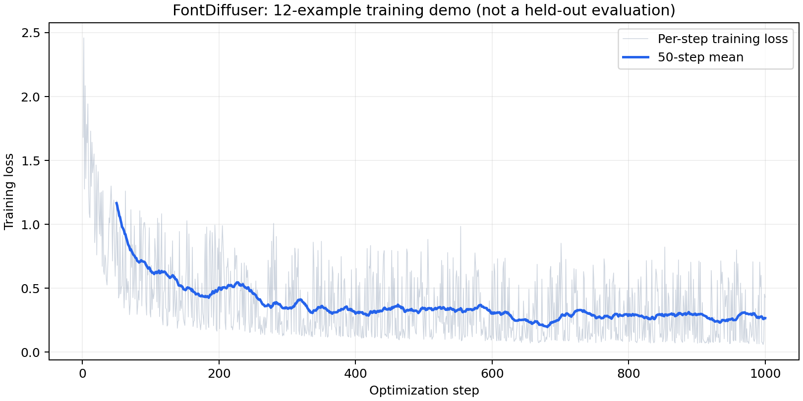
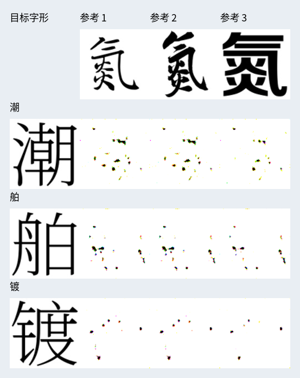

# B0.1：1000 步小数据训练与采样

日期：2026-10-09。训练执行状态：完成。图像质量验收：未通过。

## 实际完成

使用官方基础训练代码，从随机初始化训练 1000 步；没有加载官方预训练生成权重。训练数据是官方演示集，3 种字体 × 氮/潮/舶/镀 4 个汉字，共 12 张目标图。每次从同字体的另外三个字中随机抽参考。

沿用官方损失：扩散噪声 MSE + 0.01×VGG16 感知损失 + 0.5×offset 损失。batch=1，学习率 1e-4，FP32，seed=123；未启用 SCR 阶段。

训练和检查点保存均正常。随后重新严格加载 UNet、内容编码器和风格编码器的 state_dict，完成 3 个目标字 × 3 组参考的 9 张采样，同时保存官方输入样例与重复性检验。

## 训练结果

| 指标 | 值 |
|---|---|
| 优化步数 | 1000 |
| 前 50 步平均损失 | 1.16543 |
| 后 50 步平均损失 | 0.26589 |
| 第 1000 步损失 | 0.42923 |
| TensorBoard 首末记录时间间隔 | 90.48 秒 |
| 每步损失 | 全部为有限数值 |
| 重新加载训练权重 | 成功 |

时间间隔不含资源下载、模型初始化以及全部保存耗时。随机噪声与时间步使损失有波动；不能把最后一批损失当作总体收敛指标。



## 图像结果与诊断

**当前输出以白底和少量噪点为主，尚未生成可用汉字。**因此，这轮只证明训练/保存/采样闭环可执行；即使训练损失下降，也未达到字形质量要求。

基线采样使用 20 步 DPM-Solver++、CFG=7.5，图见 `sampling/contact_sheet.png`。另用 CFG=1.0 排查过强引导，结果见 `sampling_cfg1/contact_sheet.png`；仍未形成稳定字形。仅降低 CFG 没有解决问题。



以上使用训练中见过的字体与字符，尚且没有通过定性验收；不能据此推断新书写者或未见汉字的能力。问题原因尚未通过完整消融定位。12 张样例与 1000 步远小于完整训练设置；下一步应结合真实数据、训练步数、损失分项和评估设计继续诊断。

对比之下，`../baseline_001/contact_sheet.png` 是官方预训练模型的可用初步结果，二者明确分开。

## 文件与复现

- `metrics.json`：训练摘要及三个权重的 SHA-256。
- `all_steps_loss.json`、`loss_curve.csv`：TensorBoard 提取的全部 1000 步损失。
- `losses.json`：原文本日志中每 10 步记录的损失。
- `logs/`：TensorBoard 原始文件。
- `global_step_1000/`：本地训练检查点，Git 排除。
- `sampling/`、`sampling_cfg1/`：输入、输出、配置、耗时、权重校验与环境。
- `run.log`、`fontdiffuser_training.log`：原始训练日志。
- `sampling_run.log`、`sampling_cfg1_run.log`：采样日志。

在项目根目录执行：

```bash
bash scripts/run_training_demo.sh
```

同名文件会更新，请新实验使用新的输出目录。公开仓库提交报告与结果，不提交超过 GitHub 普通文件限制的模型权重；按照脚本可重新训练得到检查点。
